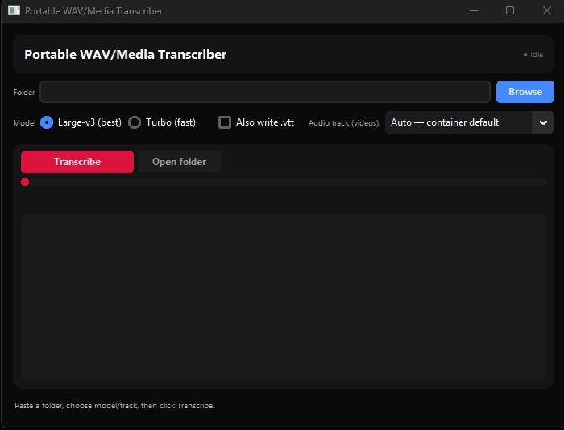

# Portable WAV/Media Transcriber

> One-click local transcriber for `wav` / `mp3` / `m4a` / `flac` / `ogg` / `aac` / `mp4` / `mov` / `mkv` / `webm` via `faster-whisper` (Large-v3 or Turbo). One `.txt` (+ optional `.vtt`) per file, written beside the source. No cloud upload after the first model download.

## Quick start — GUI (recommended)

1. Double-click `Transcribe_GUI.exe` (or `transcribe_gui.pyw` from source) — dark window opens, no console.
2. **Browse** to the folder with your media → pick **Model** (`Large-v3` best, ~3GB / `Turbo` fast, ~1.6GB) and **Audio track** for videos (defaults to `Stream 3 / Track 4` for DaVinci VO).
3. Click **Transcribe** → progress `3 / 13 — file.wav` + log shows `SKIPPED`/`DONE` per file. **Open folder** reveals the `.txt` files. Delete a `.txt` to re-transcribe it next run.

> First run: double-click `Transcribe_WAVs.bat` once — it installs portable `ffmpeg` to `.tools/`, deps to `.venv`, and the model to `%USERPROFILE%\.cache\huggingface` (needs internet + ~5GB free). Next runs are offline and skip files whose `.txt` or `.vtt` output already exists.

## Batch alternative (no GUI)

Put `Transcribe_WAVs.bat` + `transcribe_wav.py` beside your media and double-click the bat — same outputs, console log. Edit `--stream N` in the bat to change the default video audio track.

## Requirements

- Windows 10/11, Python 3.10+ on PATH (the exe needs no Python to show the window, but transcription uses the `.venv` / `.tools` created by the bat)
- Internet on first run only

## Notes

- **Video audio track:** pick it in the GUI dropdown or via CLI `--stream N` (`-1` = Auto / container default). Non-default tracks write a suffixed output (`video_s4.txt`) so different tracks never collide.
- **Subtitles:** tick **Also write .vtt** in the GUI or pass `--vtt` on the CLI.

## Docs

Full detail lives in [`doc/`](doc/README.md): [Overview](doc/overview.md) · [User Guide](doc/user-guide.md) · [Architecture](doc/architecture.md) · [Troubleshooting](doc/troubleshooting.md)
